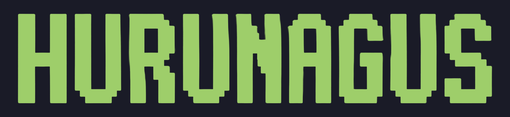

# hurunagus-hyprland




Declarative, atomic, immutable Linux system. Fedora Silverblue, Omarchy desktop, Cachyos kernel , automatic weekly updates and all the
apps I need preinstalled. It is fedora, but it is omarchy, but its Cachyos....

Reason to exist: making all my computers run identical systems, administered in
one place, from a single config. Automatic builds once a week, silently applied in the background and ready on reboot.
Stability of Fedora. Immutability and build process of Silverblue. Omarchy bling. Cachyos performance. Batteries included from Universal Blue.
The best of Linux in one distro. 


- Omarchy ported to Fedora (Omedora).
- Omedora forked and modified to function correctly on immutable Fedora (rpm-ostree / bootc).
- CachyOS kernel — from the official CachyOS Fedora port: x86_64-v3 only.
- Secure boot compatible (Enroll the key).
- Omarchy Agent skills modified to fit immutable fedora.
- Flea file manager ported to Fedora. 
- SDDM user picker — the Omarchy login theme with added user picker for multi-user systems.
- iCloud Photos, iCloud drive, iCloud calendar ready to log in.
- Google drive ready to login.
- Hyprglaze shader wallpaper- ported to fedora, menu bar widget controls.
- Huruwave - Apple music and Youtube music player (paid accounts with those services required)- browser sign in needed. 
- Hurutube - small Youtube video player: no algorithm, no shorts, no likes. Just search and play.
- Huru-wx - Detailed weather forcast & dashboard  
- Pre-install list of flatpak software.
- Hermes agent and opencode ready.
- Btrfs maintenance - monthly checking.


Be aware installed apps and features will be added or removed as I see fit at
anytime. Hence the warning to not consider this a "stable" OS for anyone except
myself. It is, despite that, a rock solid, efficient and fully featured operating
system suitable for multimedia and modern computing in 2026. I need my computer to work properly, and this does "just work". If you are the admin
for more than one machine, you should really take the time to make your own for
exactly YOUR needs, it is not too difficult and quite fun.
https://github.com/ublue-os/image-template

Install via network iso: https://github.com/wegweg7979/hurunagus-installer/releases/download/installer-20261123-4f03600/hurunagus-installer-net.iso

OR rebase an existing atomic fedora
- First rebase to the unsigned image, to get the proper signing keys and policies
  installed:
  ```sh
  rpm-ostree rebase ostree-unverified-registry:ghcr.io/wegweg7979/hurunagus-hyprland:latest
  ```
- Reboot to complete the rebase:
  ```sh
  systemctl reboot
  ```
- Then rebase to the signed image, like so:
  ```sh
  rpm-ostree rebase ostree-image-signed:docker://ghcr.io/wegweg7979/hurunagus-hyprland:latest
  ```
- Reboot again to complete the installation:
  ```sh
  systemctl reboot
  ```


Your existing `$HOME` is preserved across the rebase — atomic rebases never touch
it. That means the Omarchy defaults this image ships, the branding/screensaver files, themes,
toggles, migration markers) will **not** be seeded into your current user's home.
To adopt them, run this once **after your first login** on the new system:

```sh
omarchy-reinstall-configs
```

New users (fresh installs, or accounts created after the rebase) get these
automatically and do not need this step.


## References

- ublue-os image-template: https://github.com/ublue-os/image-template
- Omarchy: https://github.com/omacom/omarchy
- Omedora (omeadora): https://github.com/AndrewGaspar/omadora
- Original Hurunagus ublue project: https://github.com/wegweg7979/hurunagus-ublue
- hurubase — safe rebase helper: https://github.com/wegweg7979/hurunagus-rebase
